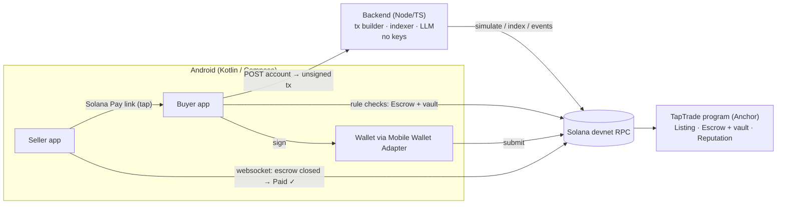

# TapTrade

**Campus trades, settled on Solana.** The buyer's money waits in an on-chain
escrow, and a tap at the in-person handoff releases it to the seller in about a
second. AI drafts the listing and explains the transaction, but only the
user's signature or the program's own rules ever move funds.

> 🎥 **Demo video:** _add link_ · Program on devnet:
> [`GpbVJKqd8upWam5fskxxkfkkz28aFAxpbbLuNDzoGnR2`](https://explorer.solana.com/address/GpbVJKqd8upWam5fskxxkfkkz28aFAxpbbLuNDzoGnR2?cluster=devnet)

## The problem

Buying a used textbook or a mini-fridge from another student today means cash,
a payment app with no recourse, or trusting a stranger to show up. Neither
side wants to pay or hand over first.

## How it works

1. **Sell in one sentence.** "sell my calc textbook for 20 USDC by Friday".
   AI drafts *Calc textbook · 20 USDC · Fri*. Before the wallet opens, the
   seller's phone checks that the transaction says exactly what they
   reviewed. The listing, title included, lives on-chain.
2. **Buy into escrow.** The buyer checks the seller's on-chain reputation, then
   locks the price in a program-owned vault: not the seller's wallet, and not
   ours. If the seller never shows, the program refunds the buyer after the
   deadline.
3. **Tap at the handoff.** The seller's phone shows a one-time Solana Pay link,
   and the buyer's phone receives it with a tap. Before signing, the buyer's
   phone decodes the release transaction and checks it against the escrow it
   reads straight from Solana. A one-line AI explanation sits on top.
4. **Paid, from the chain.** The buyer signs; it confirms in about 1 second.
   The seller's screen flips to **Paid ✓** on its own, from a websocket on the
   escrow account, with no server in the loop.

**Tampered tap?** A link that looks identical but hides an SPL Token
`approve` (which would let an attacker drain the buyer's wallet later) gets
**Blocked** on the phone, with the reason. There's no Sign button, and the AI
isn't consulted.

| Measured on devnet | |
|---|---|
| List / fund / release confirmation | ~1.1 s / ~1.1 s / ~0.8 s |
| Cost of a complete trade | ~0.000015 SOL in fees (all rent refunded) |
| Seller sees "Paid" | ~1 s after the buyer signs, via RPC websocket |

## Why Solana (and not a chain bolted onto a web app)

| | How TapTrade uses it |
|---|---|
| **Speed** | Release confirms while both people are standing there. "Paid ✓" comes from an `accountSubscribe` on the escrow, not from our backend. |
| **Low fees** | Every settled trade closes its Listing, Escrow and vault accounts and refunds the rent, so a $5 trade is viable. |
| **On-chain ownership** | Funds sit in a program vault. Listings and titles are on-chain; the backend's index rebuilds from chain on restart, with no database. |
| **Composability** | Pays in any SPL token (USDC on devnet: our own tUSDC). `Reputation` is a plain PDA any program can read. Events (`ListingCreated`, `EscrowFunded`, `EscrowReleased`, …) for indexers. Solana Pay transaction requests, plus an Actions-shaped buy endpoint, so any wallet or Blink works. |

## Trust model

- **The program holds the money and the rules.** Funds leave the vault only by
  `release` (the buyer signs) or `refund_after_deadline` (after the deadline).
  Reputation counters are written only by those two instructions.
- **The phone is the security boundary.** Before every release signature, the
  app checks:
  - the link host is our backend
  - the escrow is owned by the program and belongs to this listing
  - the buyer funded it and is the only signer
  - every instruction is TapTrade's (no stray token approvals or transfers)
  - all 12 accounts and the amount match the chain
- **The backend is a convenience.** It builds unsigned transactions (each
  simulated first), indexes accounts and events, and calls the LLM. It holds
  no keys, and nothing it says is trusted for money.
- **AI drafts and explains, never decides.** Every LLM response is strict
  JSON, validated, and backed by a non-AI fallback. The explainer sentence
  must state the real amount, or it's discarded.

## Reputation that can't be farmed

`score = 100 × (C + 1) / (C + refunded + 2×disputed + 2)`, where **C counts
at most 3 completed trades per counterparty**.

- **Counters:** come from the on-chain `Reputation` PDA.
- **Counterparties:** read from that PDA's own settle history.
- **Defaults:** a new wallet starts at 50, and two friends trading back and
  forth can't pump each other.
- **In the app:** the formula is one tap away, and the LLM only phrases a
  one-line summary of the numbers.

## Architecture



| Dir | What |
|---|---|
| [`anchor/`](anchor) | Anchor program: `create_listing`, `cancel_listing`, `fund_escrow`, `release`, `refund_after_deadline`. **27 tests** covering every invariant (no double settle, wrong signer/mint/vault/amount, rent fully refunded). |
| [`backend/`](backend) | Express + zod. Solana Pay / Actions transaction endpoints, in-memory indexer (`getProgramAccounts` + program logs), `/ai/draft-listing`, `/ai/explain`, `/reputation`. Offline tests plus an end-to-end devnet trade through the API. |
| [`android/`](android) | Compose app. Mobile Wallet Adapter, on-phone transaction decoder and explainer rules (JVM unit tests on real devnet transactions), RPC websocket, fake NFC tap via `solana:` deep link. |
| [`scripts/`](scripts) | Devnet helpers: create tUSDC, airdrop/mint, `demo-prep`, `tap.sh` (fake tap, including `--tamper`). |

## Run it

Devnet only. You'll need Rust, Solana CLI 2.1, Anchor 0.31, Node 20, and,
for the app, an x86 machine with two Android emulators (see
[docs/EMULATOR_SETUP.md](docs/EMULATOR_SETUP.md)).

```bash
# Program
cd anchor && anchor build && anchor test            # 27 passing

# Backend: holds no keys
cd backend && cp .env.example .env && npm install
npm run dev                                         # :3000 (DEMO_TAMPER=1 enables the attack demo route)
npm test && npm run e2e                             # parser tests; full trade on devnet through the API

# Test wallets
cd scripts && npm install && npm run demo-prep      # SOL + tUSDC for the demo wallets

# App
cd android && ./gradlew :app:testDebugUnitTest :app:installDebug
scripts/tap.sh            # deliver the seller's link to the buyer (the "tap")
scripts/tap.sh --tamper   # same link, hidden token approval → must be blocked
```

`LLM_API_KEY` (Anthropic) in `backend/.env` turns on the AI drafts and
sentences. Without it, everything still works with rule-based fallbacks.

## Scope and honesty notes

- **Devnet only.** The test token is our own tUSDC mint, swappable for devnet
  USDC through config.
- **No NFC hardware.** The tap is simulated with a `solana:` deep link
  (`scripts/tap.sh`). The app depends on a `TapTransport` interface, and an
  NFC implementation is stubbed.
- **Demo-only route.** The tampered-tap demo uses a backend route that exists
  only with `DEMO_TAMPER=1`.

## What's next

- Real NFC / HCE tap.
- Pay with any token via Jupiter, settling in USDC.
- An example program that reads `Reputation` via CPI.
- Photo-to-listing.
- Dispute arbitration.

---

Built by **LivingW123** for the Solana Hackathon.
